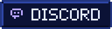
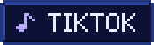
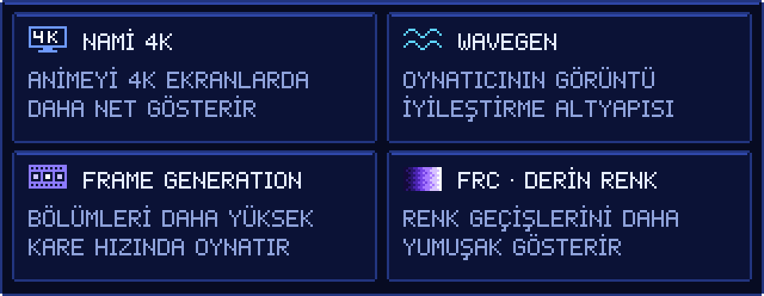
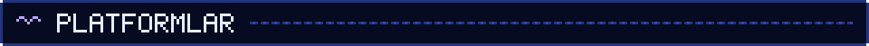
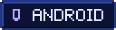
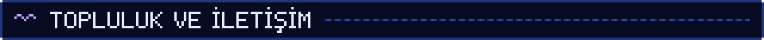
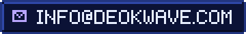

   

 

Deokwave'de Türkçe altyazılı anime izleyebilir, izlediklerini ve listelerini hesabında tutabilirsin. Birlikte İzle odalarında arkadaşlarınla aynı bölümü izleyip sesli konuşmak da mümkün. Site, Windows ve Android uygulamaları aynı hesapla çalışıyor.

Oynatıcıdaki görüntü teknolojilerini kendimiz geliştiriyoruz. Her biri için aşağıda ayrı bir depo var, içlerinde kod yok, ne işe yaradıklarını anlatıyorlar.

 

  

  

 

Soru, öneri ve hata bildirimleri için Discord sunucumuza katılabilir ya da bize e-posta gönderebilirsin.

 

 

Deokwave kapalı kaynak. Buradaki depolarda kod yok, sadece tanıtım sayfaları var.

