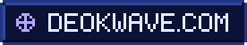
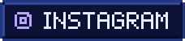
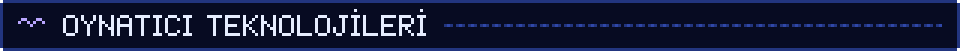
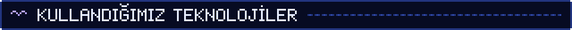
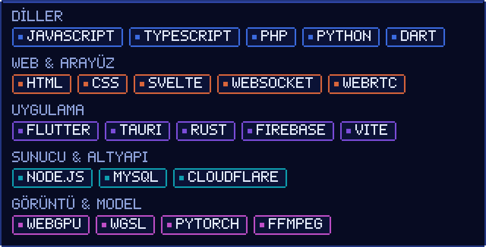
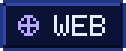
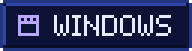

   

 

Deokwave, anime izlemekten çok daha fazlasını sunan bir anime ve topluluk platformudur. Türkçe altyazılı anime izleyebilir, kişisel izleme listeleri oluşturabilir ve yeni bölümlerden anında haberdar olabilirsin. Birlikte İzle odalarında arkadaşlarınla eş zamanlı anime izleyip sesli sohbet edebilir, diğer kullanıcılarla mesajlaşabilirsin.

Deokwave'in geliştirdiği görüntü teknolojileriyle animeleri daha yüksek çözünürlükte, daha akıcı ve gelişmiş renk kalitesiyle izleyebilirsin. XP, seviye ve başarım sistemiyle ödüller kazanabilir, profilini kişiselleştirebilir, mini oyunlar oynayabilir ve Türkiye Anime Haritası üzerinden popüler animeleri keşfedebilirsin.

Web, Windows ve Android uygulamaları aynı hesapla çalışır. İzleme geçmişin, listelerin ve hesap bilgilerin cihazlar arasında senkronize edilir.

Oynatıcıdaki görüntü teknolojilerini kendimiz geliştiriyoruz. Her biri için aşağıda ayrı bir depo var, içlerinde kod yok, ne işe yaradıklarını anlatıyorlar.

 

  

  

  

 

Soru, öneri ve hata bildirimleri için Discord sunucumuza katılabilir ya da bize e-posta gönderebilirsin.

 

 

Deokwave kapalı kaynak; sitenin ve oynatıcının kodu burada yok. Tek istisna adı piksel- ile başlayan depolar: bu sayfadaki görselleri çizen küçük araçlar.

